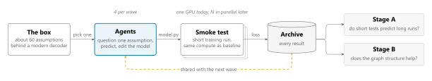

# Transformational creativity research harness

Agents question the assumptions behind a small causal-LM architecture, implement
reformulations, and test them with compute-capped training runs. The code lives in
the `cspace` package; the project itself has no name yet. The research plan is in
[SPEC.md](SPEC.md).

## How it works



Each wave, four agents pick an assumption from the box, predict what changing it will do,
edit the model, and test it with a short training run on the same compute budget as the
baseline. Every result, including dead ends, joins the archive as a child of the model it
came from, so the archive grows into a tree. The next wave branches from that tree,
starting from the current best and from the least-explored models, and one agent per wave
reconstructs from scratch in a fresh context. The agents themselves
stay fixed; what evolves is the population of models. Training is the only part that
needs a GPU; with cloud GPUs the smoke tests run in parallel (see [CLOUD.md](CLOUD.md)).
Rebuild the figure with `python docs/build_figure.py`.

## Setup

```
pip install -e .
python -m cspace prepare-data --corpus tinystories
python -m pytest -q                      # CPU only; the GPU stays hidden
```

The agent loop reads `OPENAI_API_KEY` from the environment.

## Workflow

```
python -m cspace campaign init pilot-dag --condition dag     # or --condition flat
python -m cspace campaign run pilot-dag --waves 4            # resumable
python -m cspace campaign report pilot-dag

python -m cspace cohort init calib1 --source pilot-dag       # Stage A: smoke vs long runs
python -m cspace cohort run calib1

python -m cspace study compare s1 --pair dagA:flatA          # Stage B: matched DAG/flat pairs
python -m cspace confirm init rep1 --campaign pilot-dag --seeds 1,2,3
python -m cspace confirm run rep1
```

Run `python -m cspace <command> --help` for the options.

## Layout

| Path | What it does |
| --- | --- |
| `boxes/` | The box: a dependency graph of the field's assumptions, with sources |
| `cspace/agents/` | Research loop: waves, jobs, worker tools, formulation edits |
| `cspace/evaluator/` | Lint, engineering checks, FLOP-budgeted training, probes |
| `cspace/calibration.py` | Stage A calibration cohort |
| `cspace/reporting.py` | Campaign reports, case cards, DAG-vs-flat comparison |
| `cspace/confirm.py` | Seed replication and sealed confirmation |
| `cspace/executor.py` | Where evaluations run (local now; cloud backends plug in, see [CLOUD.md](CLOUD.md)) |
| `cspace/seeds/` | Baseline decoder and known control architectures |
| `data/`, `archive/` | Generated data and results (git-ignored) |

## Key rules

- **Candidates** are a `model.py` exposing `build_model(vocab_size, context_length)`.
  They may import only torch and a few standard modules, and they must pass causality
  and determinism checks before training.
- **Budgets** are training FLOPs, counted as actually executed and identical on CPU and GPU.
  Smoke tests stop early on the same learning-rate schedule as the full run.
- **Sealed data:** the confirm split is used only through `confirm` with `--split confirm`.
  Agents never see long-run or confirmation results.
- **GPU safety:** use `--throttle 0.5` to halve sustained load, and `--temp-limit 80` to pause
  training when the GPU gets hot. Neither changes results.
